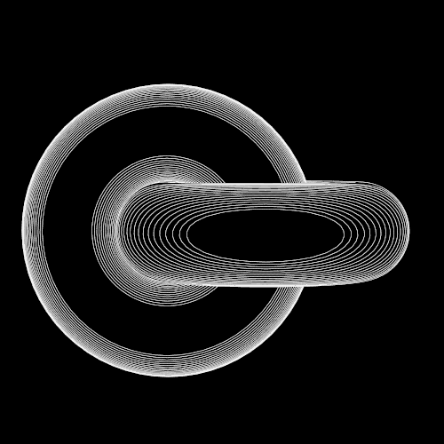
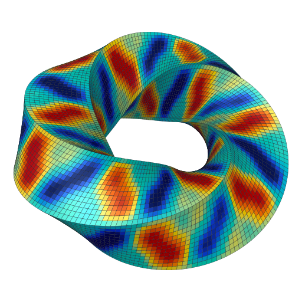

  <!-- 
    -->
  

  
   
  <b>Founder &amp; Lead Maintainer of <a href="https://github.com/archsys-solvers">archsys-solvers</a></b>
   
  <i>High-Performance Architecture-Aware Numerical Solvers in C++17</i>
    
  
  

<pre>

┌──┤ WHOAMI ├──────────────────▰▰▰
│
├─▣ Founder & Lead @ <a href="https://github.com/archsys-solvers">archsys-solvers</a>
├─▣ Software Engineer
├─▣ Low-Level Programming, Systems, Linux & HPC
│
└───────────────────────────────▰▰▰

┌──┤ ARCHSYS-SOLVERS ├─────────▰▰▰
│
├─◈ Organization: <a href="https://github.com/archsys-solvers">github.com/archsys-solvers</a>
├─◈ Flagship Repo: <a href="https://github.com/archsys-solvers/data-oriented-solver">data-oriented-solver</a>
├─◈ Join Organization: <a href="mailto:ahmed.ezzouine@um5r.ac.ma?subject=Join%20archsys-solvers%20organization">Request Invite (Click to Email)</a>
│  (Invitations and membership requests are approved personally)
│
└───────────────────────────────▰▰▰

┌──┤ SOCIAL ├──────────────────▰▰▰
│
├─◈ <a href="https://github.com/archsys-solvers">archsys-solvers</a>
├─◈ <a href="https://www.linkedin.com/in/ahmed-zouine">LinkedIn</a>
├─◈ <a href="https://twitter.com/AHMED_EZZ0UINE">Twitter / X</a>
├─◈ <a href="https://medium.com/@ahmed.ezzouine">Medium</a>
├─◈ <a href="https://g.dev/ahmedez-zouine">Google Developer</a>
├─◈ Discord: goodman
│
└───────────────────────────────▰▰▰

┌──┤ SYSTEMS & HPC ├───────────▰▰▰
│
├─◈ <a href="https://github.com/archsys-solvers/data-oriented-solver">archsys-solvers/data-oriented-solver</a>
├─◈ <a href="https://github.com/ahmedez-zouine/LAB_MPI-Tracing-Causality-Analysis">LAB_MPI-Tracing-Causality-Analysis</a>
├─◈ <a href="https://github.com/ahmedez-zouine/kvm-ubuntu-iptables">kvm-ubuntu-iptables</a>
│
└───────────────────────────────▰▰▰

┌──┤ 42 PROJECTS ├─────────────▰▰▰
│
├─◈ <a href="https://github.com/ahmedez-zouine/libft">libft</a>
├─◈ <a href="https://github.com/ahmedez-zouine/get_next_line">get_next_line</a>
├─◈ <a href="https://github.com/ahmedez-zouine/ft_printf">ft_printf</a>
├─◈ <a href="https://github.com/ahmedez-zouine/Born2beRoot">Born2beRoot</a>
├─◈ <a href="https://github.com/ahmedez-zouine/Frac2L">Frac2L</a>
├─◈ <a href="https://github.com/ahmedez-zouine/push_swap">push_swap</a>
├─◈ <a href="https://github.com/ahmedez-zouine/parallels">parallels</a>
├─◈ <a href="https://github.com/ahmedez-zouine/G_cub3D">G_cub3D</a>
├─◈ <a href="https://github.com/ahmedez-zouine/longtalk">longtalk</a>
├─◈ <a href="https://github.com/ahmedez-zouine/Ttway">Ttway</a>
│
└───────────────────────────────▰▰▰

┌──┤ ALX PROJECTS ├────────────▰▰▰
│
├─◈ <a href="https://github.com/ahmedez-zouine/alx-low_level_programming">alx low level programming</a>
├─◈ <a href="https://github.com/ahmedez-zouine/alx-higher_level_programming">alx higher level programming</a>
├─◈ <a href="https://github.com/ahmedez-zouine/Fix_My_Code_Challenge">Fix My Code Challenges</a>
├─◈ <a href="https://github.com/ahmedez-zouine/AirBnB_clone">AirBnB clone Project</a>
├─◈ <a href="https://github.com/ahmedez-zouine/Sort_Algorithms">Sort Algorithms</a>
├─◈ <a href="https://github.com/ahmedez-zouine/alx-frontend-javascript">alx Frontend Javascript</a>
├─◈ <a href="https://github.com/ahmedez-zouine/alx-interview">alx Interview</a>
│
└───────────────────────────────▰▰▰

</pre>

---

### Join archsys-solvers

I founded **[archsys-solvers](https://github.com/archsys-solvers)** to build open-source, architecture-aware numerical solvers and high-performance computing libraries in C++17.

We actively welcome developers, contributors, and systems enthusiasts to join the organization!

* **Explore the Organization:** [github.com/archsys-solvers](https://github.com/archsys-solvers)
* **Direct Link to Join:** Send an email to **[ahmed.ezzouine@um5r.ac.ma](mailto:ahmed.ezzouine@um5r.ac.ma?subject=Join%20archsys-solvers%20organization)** with your GitHub username or connect via [LinkedIn](https://www.linkedin.com/in/ahmed-zouine).
* **Invitation Approval:** I personally review and approve all membership and collaborator requests.
